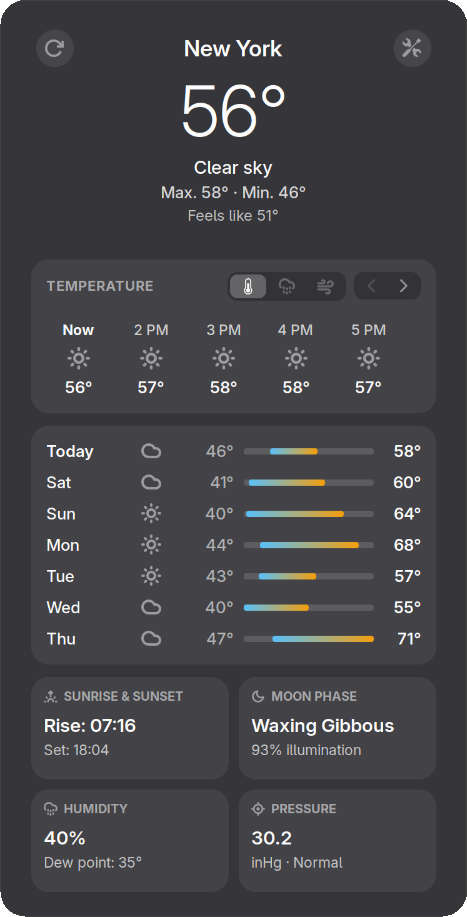
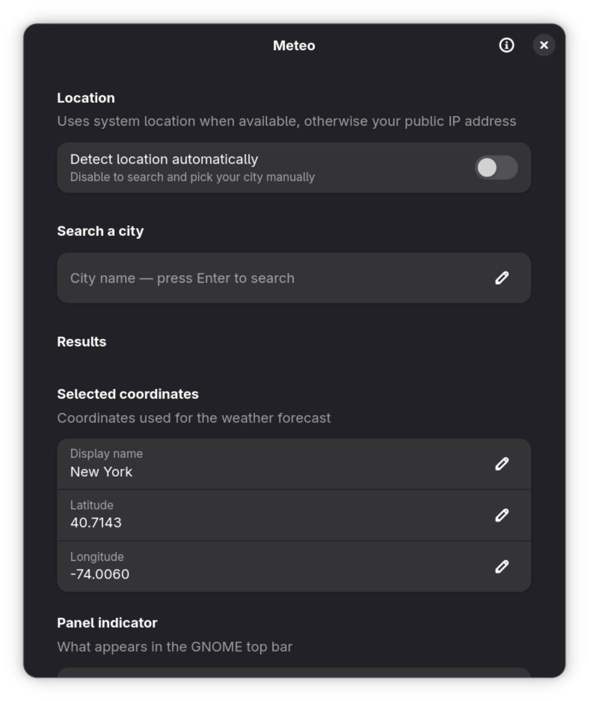

# GnomeMeteo

> **Elegant weather indicator and forecast for GNOME Shell 45+**

GnomeMeteo is a lightweight, modern weather extension for the GNOME desktop, featuring a clean card-based weather popup, native Libadwaita styling, multi-provider weather forecasts, and smooth segmented metric switching.

<p align="center">
  
  &nbsp; &nbsp;
  
</p>

---

## 🚀 Quick Install (One-Liner)

Install or update GnomeMeteo with a single command (no `git clone`, no `sudo`):

```bash
curl -fsSL https://raw.githubusercontent.com/OleksiyM/GnomeMeteo/main/install.sh | bash
```

The installer installs to your user directory (`~/.local/share/gnome-shell/extensions/meteo@oleksiym.github.io/`), compiles schemas and translations, and activates the extension live.

To install a specific release version:
```bash
curl -fsSL https://raw.githubusercontent.com/OleksiyM/GnomeMeteo/main/install.sh | bash -s -- --version v1.0.0
```

---

## ✨ Features

* **Visual Hierarchy:** Clean 3-tier main condition block (prominent temperature, condition name, daily max/min range, feels-like).
* **Segmented Metric Switcher:** Instantly toggle between **Temperature**, **Precipitation Probability**, and **Wind Speed** across both hourly and daily views.
* **Native Libadwaita Gradients:** Smooth daily temperature range bars built with native St gradient syntax.
* **Compact 2×2 Details Grid:** At-a-glance cards with monochrome Adwaita symbolic icons for:
  * 🌅 Sunrise & Sunset
  * 🌔 Moon Phase (astronomically computed with illumination %)
  * 💧 Humidity & Dew Point
  * 🧭 Atmospheric Pressure (mmHg)
* **Zero Precipitation De-emphasis:** Days with 0% rain probability are gracefully dimmed to highlight relevant weather.
* **Keyless Multi-Provider Support:**
  * **Open-Meteo** (global, with choice of prediction models: ECMWF IFS, DWD ICON, GFS, etc.)
  * **MET Norway** (api.met.no, CC BY-SA 4.0)
  * **NOAA NWS** (United States official forecasts)
* **Clean Single-Page Preferences:** Fast, scrollable Libadwaita settings dialog with instant top-bar indicator toggles and localized city search.
* **Full Localization:** Native Ukrainian, English, and Russian translations.
* **Privacy by Design:** No tracking, no accounts, no API keys. Direct requests to public meteorological APIs.

---

## 💻 Compatibility

* **GNOME Shell:** 45, 46, 47, 48, 49, 50+
* **Session:** Wayland and X11

---

## 🗑️ Uninstallation

To remove GnomeMeteo:

```bash
curl -fsSL https://raw.githubusercontent.com/OleksiyM/GnomeMeteo/main/uninstall.sh | bash
```

Or from your local machine:
```bash
~/.local/share/gnome-shell/extensions/meteo@oleksiym.github.io/uninstall.sh
```

---

## 📜 Acknowledgements & Lineage

GnomeMeteo is created and maintained by [OleksiyM](https://github.com/OleksiyM).
It is developed as a focused, modernized GNOME Shell extension evolved from the original [Weatherglass](https://github.com/vijaybala-lang/weatherglass) project created by Vijay Bala. Full lineage and copyright credit are preserved under the [GNU General Public License v3.0](LICENSE).
