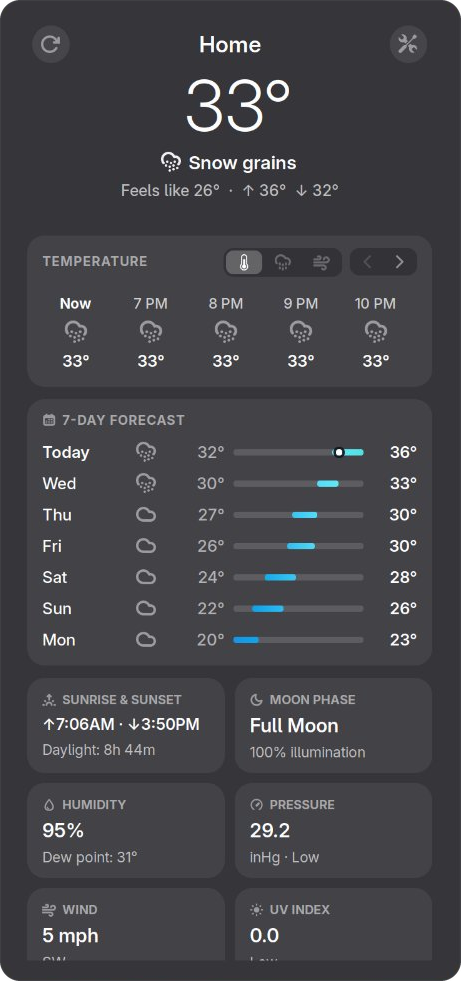
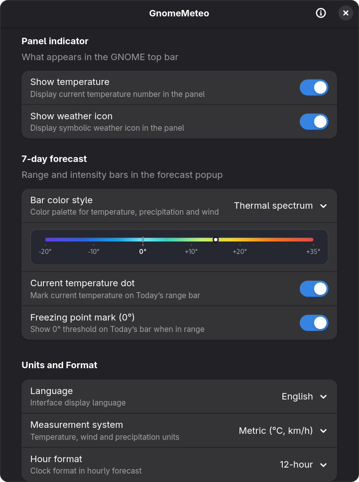

# GnomeMeteo

> **Elegant weather indicator and forecast for GNOME Shell 45–50+**

GnomeMeteo is a lightweight, modern weather extension for the GNOME desktop, featuring a clean card-based weather popup, native Libadwaita styling, multi-provider weather forecasts, and smooth segmented metric switching.

<p align="center">
  
  &nbsp; &nbsp;
  
</p>

---

## 🚀 Quick Install & Update (One-Liner)

Install or update GnomeMeteo with a single command (no `git clone`, no `sudo`):

```bash
curl -fsSL https://raw.githubusercontent.com/OleksiyM/GnomeMeteo/main/install.sh | bash
```

The installer automatically verifies `SHA256SUMS` and Sigstore SLSA v1 release provenance (via `gh attestation verify` when GitHub CLI is available), installs to `~/.local/share/gnome-shell/extensions/meteo@oleksiym.github.io/`, and activates the extension live.

To install a specific release version or strictly enforce provenance verification:
```bash
curl -fsSL https://raw.githubusercontent.com/OleksiyM/GnomeMeteo/main/install.sh | bash -s -- --version v1.2.1 --require-provenance
```

---

## ✨ Features

* **Balanced Hero Header:** Optically centered current temperature, symbolic condition row, and compact feels-like + `↑ max° ↓ min°` summary synced live with the `"Now"` forecast slot.
* **Segmented Metric Switcher:** Toggle seamlessly across both 24-hour and 7-day views between **Temperature**, **Precipitation** (type-aware snow/rain/storm icons, daily `mm`/`in` volume alongside probability `%`, and dimmed `< 10%` model noise), and **Wind** (speed + compass direction arrows and labels).
* **Thermal Spectrum & Minimalist Themes:** Choose between **Thermal Spectrum** (physically grounded `−20°C … +35°C` temperature colors, precipitation intensity, and Beaufort wind scale) and **Minimalist** (monochrome Libadwaita slate-to-pearl), complete with Today’s **current-temperature dot** and **0° freezing threshold mark**.
* **Interactive Libadwaita Preferences:** Clean single-page GTK4/Libadwaita dialog featuring a **live Cairo scale preview**, smart panel toggles, and localized city search.
* **Adaptive `2×2` Details Cards:** Evenly balanced tiles with monochrome symbolic icons:
  * 🌅 **Sunrise & Sunset** (`↑ Rise  ↓ Set`) with computed **Daylight duration**
  * 🌔 **Moon Phase** (astronomically computed with illumination %)
  * 💧 **Humidity & Dew Point**
  * 🧭 **Atmospheric Pressure** (`mmHg` / `inHg` with dynamic Low / Normal / High level)
  * 🌬️ **Wind** with compass direction, ☀️ **UV Index** with level, 👁️ **Visibility**
* **Keyless Multi-Provider Support:**
  * **Open-Meteo** (global, with choice of prediction models: Best match, ECMWF IFS, DWD ICON, GFS, GEM)
  * **MET Norway** (`api.met.no`, CC BY-SA 4.0)
  * **NOAA NWS** (United States official forecasts)
* **Honest Data:** If a provider does not supply a value (e.g. rain probability from MET Norway), the popup shows “—” instead of an invented number.
* **Unified Live Localization:** Complete Ukrainian, English, and Russian translations synced instantly across both the GNOME Shell popup and the Libadwaita Preferences window, with Metric (`°C`, `km/h`, `mm`, `mmHg`) and Imperial (`°F`, `mph`, `in`, `inHg`) units.
* **Privacy & Supply-Chain Security:** No tracking, no accounts, no API keys. Releases are attested with Sigstore SLSA v1 provenance.

---

## 🧭 Choosing a Provider & Forecast Model

Preferences contain an **(i)** button next to *Provider* and *Forecast model* with the same hints. Summary (checked against live API responses):

| Provider | Best for | Limitations |
|---|---|---|
| **Open-Meteo** | Everywhere, **including Ukraine** — the default | Depends on the chosen model (see below) |
| **MET Norway** | Europe; a good independent second opinion | No rain probability % (daily bars fall back to mm totals) and no visibility (shown as “—”); sunrise/sunset only for today |
| **NOAA NWS** | **United States only** | Other regions return an error |

| Forecast model (Open-Meteo) | When to use | Limitations |
|---|---|---|
| **Best match** | Default. Picks the best local models automatically (ICON / ECMWF in Europe) | — |
| **ECMWF IFS** | Europe, longer range (days 3–7) | No UV index |
| **DWD ICON** | Central and Eastern Europe | No UV index |
| **NOAA GFS** | North America | — |
| **GEM** | North America | No UV index, visibility or CAPE |

> 🇺🇦 **Ukraine:** use **Open-Meteo + Best match**; switch to **ECMWF IFS** only if you prefer its longer-range forecast. NOAA NWS will not work here.

**Automatic location** uses GeoClue, then falls back to IP lookup. IP geolocation is accurate to the city level and can be far off with a VPN, mobile network, or corporate proxy — in that case disable it and pick your city manually.

---

## 💻 Compatibility

* **GNOME Shell:** 45, 46, 47, 48, 49, 50+
* **Session:** Wayland and X11

---

## 🗑️ Uninstallation

To remove GnomeMeteo (keeping your saved preferences):

```bash
curl -fsSL https://raw.githubusercontent.com/OleksiyM/GnomeMeteo/main/uninstall.sh | bash
```

To remove GnomeMeteo and purge all saved GSettings preferences:

```bash
bash ~/.local/share/gnome-shell/extensions/meteo@oleksiym.github.io/uninstall.sh --purge
```

---

## 📜 Acknowledgements & Lineage

GnomeMeteo is created and maintained by [OleksiyM](https://github.com/OleksiyM).
It is developed as a focused, modernized GNOME Shell extension evolved from the original [Weatherglass](https://github.com/vijaybala-lang/weatherglass) project created by Vijay Bala. Full lineage and copyright credit are preserved under the [GNU General Public License v3.0](LICENSE).
